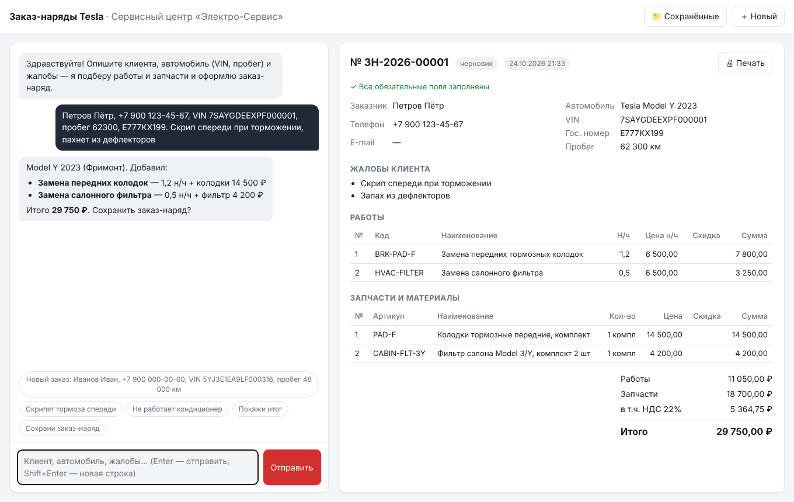

# DK-TeslaService

Помічник із замовлень-нарядів на ремонт автомобілів Tesla.

AI-помічник майстра-приймальника: у вільній формі описуєте клієнта, автомобіль і проблему —
помічник (Claude) розшифровує VIN, підбирає роботи та запчастини з довідника сервісу, рахує
підсумок і зберігає замовлення-наряд у JSON і HTML для друку. Валюта — долари США, ПДВ не нараховується.

Приклад друкованої форми: [`examples/zamovlennia-nariad-pryklad.html`](examples/zamovlennia-nariad-pryklad.html).

## Встановлення і запуск

```bash
pip install -e ".[dev]"
export ANTHROPIC_API_KEY=sk-ant-...
python -m tesla_ro.web        # або: tesla-ro-web
```

Відкрийте в браузері http://127.0.0.1:8000.



- **Ліворуч — чат із помічником.** Пишіть у вільній формі, можна все одразу:
  «Петренко Петро, +380 67 123 45 67, VIN 7SAYGDEEXPF000001, пробіг 62300, скрипить спереду
  під час гальмування».
- **Праворуч — замовлення-наряд**, оновлюється після кожної відповіді: клієнт, автомобіль,
  скарги, роботи, запчастини, підсумок і список незаповнених обов'язкових полів.
- **📷 Фото** — сфотографуйте табличку чи наклейку з VIN, екран із VIN або одометр: Claude
  прочитає VIN і пробіг (милі переводяться в км), VIN перевіряється за контрольною цифрою.
  Результат підставляється в поле введення — перевірте й надішліть.
- **📝 Заповнити вручну** — порожнє замовлення-наряд без помічника (кнопка на порожній панелі
  та кнопка під чатом): замовник і автомобіль — у формі ✎ (модель і рік — за VIN, з
  попередженням, якщо VIN не сходиться), скарги й рекомендації — полем «Додати…» та ✕,
  діагностика — ✎. Помічником можна скористатися будь-коли — він дізнається про ручні правки.
- **💬 Внутрішні коментарі** співробітників до кожного замовлення-наряду (хто, коли, звідки —
  сайт чи Telegram). Лише для своїх: у друковану форму не потрапляють. Ім'я автора браузер
  запам'ятовує; нові коментарі з Telegram з'являються в панелі самі (раз на 20 с). Зберігаються
  окремо від замовлень: `orders/comments/<номер>.jsonl`.
- **📷 Фото** до замовлення-наряду: «до», «після», «пошкодження», «інше» — кнопка «Додати фото»
  в панелі (з телефона можна знімати одразу камерою, кілька фото за раз; фото зменшуються до
  1600 px). Позначка «клієнту» — бот надішле це фото клієнту разом із PDF. Фото, надіслане в
  Telegram-групу відповіддю на картку замовлення (чи з номером у підписі), теж додається;
  підпис «до» / «після» / «пошкодження» задає тип. Зберігаються в `orders/photos/<номер>/`.
- **🗑 Видалення** замовлення-наряду — у панелі та в «Збережені», з підтвердженням. Файл
  переноситься в кошик `orders/deleted/` (звідти його можна повернути вручну, перемістивши
  назад у `orders/`); номер видаленого замовлення повторно не видається.
- **Ручне редагування** будь-якого, зокрема збереженого, замовлення-наряду просто в панелі, без
  помічника: ✎ — змінити кількість, ціну, знижку рядка; ✕ — видалити; «＋ Додати роботу /
  запчастину» — з довідника (роботи відфільтровано за моделлю авто, можна з типовими
  запчастинами) або власна позиція. Зміни зберігаються одразу; для статусів «видано» і
  «скасовано» спершу перепитує. Помічник дізнається про ручні правки з наступним повідомленням.
- **Статус** замовлення-наряду змінюється просто в панелі: чернетка → прийнято → в роботі →
  готово → видано, або скасовано. Кожна зміна записується з датою, часом і ім'ям того, хто
  змінив (ім'я — те, що вказане в коментарях). Час — київський, навіть якщо сервер у UTC.
- **🖨 Друк** відкриває друковану форму (з браузера можна зберегти в PDF).
- **📤 Клієнту** — надіслати клієнту PDF замовлення-наряду:
  - «Поділитися PDF» відкриває меню «Поділитися» телефона — вибираєте Telegram (чи Viber) і чат
    клієнта; на комп'ютері — «Відкрити PDF» і надіслати файл вручну;
  - через бота (якщо Telegram налаштовано): клієнт сканує QR-код або відкриває посилання й
    натискає «Старт» — бот одразу надсилає йому PDF і запам'ятовує його за телефоном; наступні
    замовлення-наряди цьому клієнту — однією кнопкою «Надіслати PDF через бота». Telegram не
    дозволяє ботам першими писати людям, тому без цього «Старт» бот клієнту написати не може;
  - **📝 Надіслати на погодження** — клієнт отримує кошторис (PDF) з кнопками «✅ Погоджую /
    ❌ Відмовляюсь». Відповідь з'являється в панелі замовлення («Клієнт погодив кошторис на
    222,00 $ · дата»), у внутрішніх коментарях і в Telegram-групі. Якщо після погодження сума
    змінилась, панель про це попереджає.
- **«Ваш автомобіль готовий»**: коли статус змінюється на «готово», бот сам пише клієнту (якщо
  він підключений до бота) — з номером замовлення-наряду, сумою до сплати й адресою сервісу.
  Один раз на замовлення-наряд.
- **Витрати на Claude** рахуються з кожної відповіді API (токени × тарифи моделі): у панелі
  замовлення-наряду — «Claude: $0,43 · запитів: 12», у «Збережені» — колонка Claude, у
  «Довідник → Налаштування» — сьогодні, місяць, усього, середнє на замовлення-наряд і графік
  за 2 тижні. Клієнт цього не бачить: у друковану форму витрати не потрапляють. Журнал —
  `usage.jsonl` поруч із `orders/` (у Docker — `/data/usage.jsonl`). Тарифи — у
  `tesla_ro/usage.py`; точна сума рахунку — у console.anthropic.com → Usage.
- **Прайс в Excel** (Довідник → Налаштування): «Вивантажити в Excel» — аркуші «Роботи» і
  «Запчастини»; змініть ціни чи додайте рядки й «Завантажити з Excel». Спершу показується, що
  буде додано й змінено і які рядки з помилками; зміни застосовуються після підтвердження.
  Рядки звіряються за кодом роботи й артикулом; рядки, яких немає у файлі, не видаляються.
- **Резервна копія** (Довідник → Налаштування → «Завантажити архів»): ZIP із замовленнями
  (разом із кошиком), коментарями, фото, довідником, витратами й даними бота. Щоночі о 03:00
  (за Києвом) бот надсилає таку копію власнику в Telegram — див. нижче `BACKUP_CHAT_ID`.
- **💵 Оплата** в панелі замовлення-наряду: «Прийняти оплату» — сума (за замовчуванням — залишок),
  спосіб (готівка, картка, переказ), примітка; передоплата вноситься так само, повернення — сума з
  мінусом. Статус оплати: не оплачено / частково / оплачено / переплата; помилково внесену
  оплату можна видалити. Перед статусом «видано» з несплаченим залишком сайт перепитує
  («видати в борг?»), а бот пише в групі «⚠️ борг». У друкованій формі — «Сплачено» і
  «Залишок до сплати»; клієнту в Telegram — сума з урахуванням передоплати.
- **💰 Каса**: «Каса за день» — усього й окремо готівка, картка, переказ, список оплат (будь-який
  день); «Боржники» — видані автомобілі з несплаченим залишком і замовлення з переплатою
  (повернути). Борг видно й у «Клієнти» та «Збережені». У вечірньому підсумку власнику —
  отримано за день і борги.
- **📦 Склад** (Довідник → Склад): залишки запчастин із довідника, резерв (вписані в замовлення,
  які ще не видано), мінімальний залишок. «＋» — прихід (постачальник, накладна), «⚖» —
  інвентаризація (фактичний залишок), мінімум та історія руху. Запчастини списуються самі,
  коли замовлення-наряд отримує статус «видано» (повернення статусу — повертає на склад;
  правка виданого — списує різницю; власні позиції не з довідника склад не чіпають;
  замовлення, видані до запуску складу, не списуються заднім числом). Коли залишок доходить
  до мінімуму — бот пише в групу «📦 Закінчується»; «Що замовити (Excel)» — список для
  постачальника. У замовленні під запчастиною видно «на складі: N», помічник теж бачить залишки.
- **🏠 Головна** — стартова сторінка (кнопка «🏠 Головна», вкладка на телефоні або натискання на
  назву сервісу):
  - показники дня: прийнято, в роботі, готово до видачі, записів сьогодні, отримано сьогодні, борги
    (натискання веде до відповідного розділу);
  - **⚠ Потребує уваги**: довго в роботі, клієнт не відповів на кошторис, готове авто не забрали
    понад 2 дні, борги, склад закінчується, записаний клієнт ще не позначений «приїхав»;
  - **дошка замовлень у роботі** плитками за стадіями «Прийнято → В роботі → Готово»: авто, клієнт,
    роботи, сума, оплата, погодження, відповідальний, скільки часу в цій стадії (червоне — довго);
    кнопка на плитці переводить у наступну стадію («🔧 В роботу», «✅ Готово», «🏁 Видано»), натискання
    на плитку відкриває замовлення; на телефоні стадії перемикаються вкладками;
  - **записи на сьогодні** з кнопкою «🚗 Приїхав → замовлення» і кількість записів на завтра;
  - незавершені чернетки, «↩ Продовжити» відкрите замовлення, швидкі дії, фільтр «Лише мої»
    (за ім'ям із коментарів). Сторінка оновлюється сама кожні 30 секунд — її можна тримати
    відкритою на екрані в майстерні.
- **📋 Акт приймання автомобіля** (у панелі замовлення): комплектність (ключ-карта, зарядний
  кабель, килимки…), що залишено в салоні, пошкодження й зауваження; фото з типом «до» і
  «пошкодження» потрапляють в акт. **✍ Підпис клієнта** — пальцем на екрані телефона чи
  планшета. «🖨 Акт» — друкована форма (і PDF); підписаний акт бот надсилає клієнту разом із
  замовленням-нарядом. Якщо змінити зміст акта після підпису — підпис знімається.
- **📅 Запис** — планувальник записів клієнтів на сервіс, окремо від замовлень-нарядів. Угорі
  поле для помічника: пишіть або надиктуйте (🎤 — голосове введення, як у чаті) як завгодно — «Петренко, Model Y, у пʼятницю о 10, ТО і стукіт»,
  «перенеси Коваль на завтра 12:00», «скасуй запис Сидоренка», «хто в нас на четвер?». Помічник
  сам рахує дати («завтра», «наступного вівторка»), підтягує телефон і авто з бази клієнтів,
  перепитує, якщо бракує дня чи часу. Обмежень на кількість машин одночасно немає — лише
  попередження «⚠ Накладка». Нижче — тиждень записів (◀ ▶), кнопки «✎ Змінити», «Не приїхав»,
  «Скасувати», «＋ Вручну» і **«🚗 Приїхав → замовлення»**: замовлення-наряд створюється лише за
  цією кнопкою, з клієнтом, авто й роботами із запису. У Telegram-групі кожен запис з'являється
  повідомленням і оновлюється при змінах; `/zapys <текст>` — записати з групи, `/zapys` — записи
  на сьогодні й завтра, відповідь на повідомлення про запис («перенеси на 12») — змінити його;
  щоранку о 8:00 бот надсилає в групу записи на день. Клієнту, підключеному до бота, приходить
  «Вас записано…», а також повідомлення про перенесення чи скасування. Записи — у
  `bookings.json` поруч з `orders/` (входять у резервну копію).
- **👥 Клієнти** — база клієнтів, зібрана із замовлень-нарядів: один клієнт = один телефон
  («+380 67 …» і «067 …» — той самий), без телефону — за ПІБ. Для кожного: автомобілі, кількість
  візитів, загальна сума, перший і останній візит, усі замовлення-наряди, позначка «📲 Telegram»
  (з датою підключення до бота або «заблокував бота»). Пошук за ПІБ, телефоном, VIN чи
  держномером; фільтри «у Telegram», «не були 6+ / 12+ міс.»; вивантаження в Excel. З картки
  клієнта — «＋ Нове замовлення» (або на конкретне авто): ПІБ, телефон і автомобіль
  підставляються самі, лишається вказати пробіг і скарги.
- **📣 Розсилка** в Telegram клієнтам, які підключились до бота (Клієнти → Розсилка): шаблони
  «Нагадування про ТО», «Сезонна заміна шин» або свій текст; підстановки `{ім'я}`, `{авто}`,
  `{сервіс}`, `{адреса}` і приклад повідомлення; отримувачі — за поточним фільтром і пошуком,
  кожного можна зняти галочкою. Наприклад, фільтр «не були 12+ міс.» + «Нагадування про ТО».
  Хто заблокував бота, позначається й надалі пропускається. Журнал розсилок — там само.
- **📁 Збережені** — список замовлень-нарядів із пошуком за VIN, телефоном, ПІБ, держномером
  чи номером і фільтром за статусом: відкрити для редагування або надрукувати.
- **＋ Нове** — почати нове замовлення-наряд.
- **Ярлик на головному екрані телефона**: iPhone — Safari → «Поділитися» → «На екран „Додому“»;
  Android — Chrome → ⋮ → «Додати на головний екран» (або «Встановити застосунок»). Ярлик має
  іконку «DK», відкривається на весь екран без адресного рядка, як застосунок. На iPhone після
  першого відкриття з ярлика пароль, імовірно, доведеться ввести ще раз (ярлик має окреме від Safari сховище).
- На телефоні чат і замовлення-наряд перемикаються вкладками. Угорі — «＋ Нове» і «☰ Меню»
  (Збережені, Запис, Клієнти, Каса, Довідник, Вийти). «Збережені» — картками: торкніться картки,
  щоб відкрити. Коли прокручуєте замовлення-наряд, угорі закріплюється смужка: номер, статус,
  сума, залишок до сплати й переходи до розділів (Клієнт, Роботи, Оплата, Фото, Коментарі).
  Історія автомобіля згорнута — відкривається натисканням. Кнопки й поля збільшено під палець,
  а шрифт у полях — 16 px, щоб iPhone не збільшував сторінку під час введення.

**Автозбереження.** Замовлення-наряд записується на диск як чернетка після кожної зміни
(порожні чернетки не зберігаються). Якщо сервер перезапуститься, сторінка сама відкриє
останнє замовлення-наряд; переписка в чаті при цьому не зберігається. Кнопка «Нове» скидає це.

Збережені замовлення-наряди лежать у `orders/` (JSON), робочий довідник — у `catalog.json`
поруч із каталогом `orders/`, там само `.auth_secret` — ключ підпису входу (у Docker усе це
в `/data`).

Параметри (аргументи або змінні оточення): `--host`/`HOST`, `--port`/`PORT`,
`--orders-dir`/`ORDERS_DIR`, `--catalog`/`CATALOG` (файл робочого довідника),
`--model`/`MODEL`, `--effort`/`EFFORT`.

## Розміщення на сервері

Для доступу з інтернету обов'язковий пароль: змінна `APP_PASSWORD` (щонайменше 8 символів).
Без неї сервіс на адресі, відмінній від `127.0.0.1`, не запуститься. Вхід діє 30 днів і
переживає перезапуски сервера (після зміни пароля всім треба увійти заново);
після 10 невірних паролів з однієї адреси вхід блокується на 15 хвилин.

### Render (найпростіше)

1. Зареєструйтеся на https://render.com і підключіть GitHub.
2. **New → Blueprint**, виберіть цей репозиторій — Render прочитає `render.yaml`.
3. Введіть значення `ANTHROPIC_API_KEY` і `APP_PASSWORD`, натисніть **Apply**.
4. За кілька хвилин сервіс буде доступний за адресою на кшталт
   `https://tesla-repair-orders.onrender.com` — відкрийте її з телефона та увійдіть.

У `render.yaml` вказано тариф **Starter** (платний) з диском 1 ГБ — на ньому зберігаються
замовлення-наряди. На безкоштовному тарифі диска немає: замовлення-наряди зникатимуть після
кожного перезапуску.

### Власний сервер (VPS) з Docker

```bash
docker build -t tesla-ro .
docker run -d --restart unless-stopped -p 8000:8000 \
  -e ANTHROPIC_API_KEY=sk-ant-... -e APP_PASSWORD='надійний-пароль' \
  -v tesla-ro-data:/data tesla-ro
```

Перед сервісом поставте HTTPS (наприклад, Caddy: `caddy reverse-proxy --from ваш-домен --to :8000`).
Звичайним HTTP пароль передається відкритим текстом. Якщо HTTPS немає зовсім, додайте
`-e COOKIE_SECURE=0`, інакше браузер не збереже вхід.

Консольна версія: `python -m tesla_ro`.

## Telegram: замовлення й коментарі в робочій групі

Бот публікує в групу співробітників картку кожного замовлення-наряду, щойно воно виходить зі
статусу «чернетка», оновлює її при змінах і пише під нею про зміну статусу. **Відповідь (Reply)
на картку** — це внутрішній коментар до замовлення; так само повідомлення, що починається з
номера: `ЗН-2026-00001 замінили колодки`. Бот ставить 👍 — коментар збережено. Коментарі з сайту
бот публікує відповіддю під карткою. Команди: `/orders` — що зараз у роботі,
`/order ЗН-2026-00001` — картка з усіма коментарями, `/my` — мої замовлення, `/help`.

- **Кнопки під карткою**: «🔧 В роботу» → «✅ Готово» → «🏁 Видано» — статус змінюється просто
  з Telegram (бот пише під карткою, хто змінив; якщо бракує обов'язкових полів — покаже, яких).
  «👤 Беру собі» — стати відповідальним за замовлення. Панель на сайті підхоплює ці зміни сама.
- **Голосові коментарі**: голосове повідомлення відповіддю на картку зберігається як коментар —
  його можна прослухати чи завантажити в панелі замовлення на сайті. (Перетворення голосу на
  текст потребує окремого сервісу розпізнавання мовлення — Claude аудіо не приймає.)
- **Відповідальний майстер** — поле «👤 Відповідальний» у панелі замовлення (з підказками імен)
  або кнопка «Беру собі» в Telegram. Показується в картці й у `/orders`.
- **Підсумок дня власнику** (у чат `BACKUP_CHAT_ID`) щовечора о 20:00: скільки прийнято, готово,
  видано і на яку суму, що зараз у роботі й у кого, що чекає погодження клієнтом і що
  **довго в роботі** (понад 2 дні — з відповідальним). На вимогу — командою `/today` в
  особистому чаті з ботом.

Налаштування (один раз):

1. У Telegram відкрийте **@BotFather** → `/newbot`, задайте назву — отримаєте **токен**.
2. Там само `/setprivacy` → ваш бот → **Disable**, щоб бот бачив повідомлення, що починаються
   з номера замовлення (відповіді на його повідомлення він бачить і так).
3. Створіть групу, додайте співробітників, себе й бота.
4. Render → сервіс → **Environment** → додайте `TELEGRAM_BOT_TOKEN` = токен → Save.
5. Після перезапуску напишіть у групі `/chatid` — бот відповість числом на кшталт `-1001234567890`.
6. Додайте в Render `TELEGRAM_CHAT_ID` = це число → Save. Напишіть у групі `/help`.

**Щоденна резервна копія в Telegram.** Напишіть боту в особисті повідомлення `/chatid` —
він відповість вашим ID. Додайте в Render `BACKUP_CHAT_ID` = це число → Save. Щоночі о 03:00
бот надсилатиме вам ZIP-архів (якщо з фото архів більший за ліміт Telegram у 50 МБ, фото не
додаються — повну копію можна завантажити в «Довідник → Налаштування»). Копію на вимогу —
командою `/backup` в особистому чаті з ботом (лише з чату власника). Ключ входу `.auth_secret`
до копії не входить.

Бот працює лише з цією групою — повідомлення з інших чатів ігнорує. Зв'язки «повідомлення ↔
замовлення» зберігаються в `telegram.json` поруч з `orders/` (у Docker — `/data/telegram.json`).
Бот отримує повідомлення через long polling, тож потрібен рівно один запущений екземпляр сервісу.

## Що вміє

- **VIN Tesla**: модель (S/3/X/Y/Cybertruck), модельний рік, завод, перевірка контрольної цифри
  для північноамериканських VIN (`tesla_ro/vin.py`).
- **База робіт Tesla** — `tesla_ro/data/catalog.json`: 72 основні роботи в 10 розділах
  (діагностика, ТО, шини, гальма, підвіска й кермо, клімат, високовольтна система, привід,
  електрика, кузов), для кожної — фіксована ціна, моделі, типові запчастини та рекомендований
  інтервал обслуговування; 34 позиції запчастин із цінами. Там само реквізити сервісу, валюта
  і ПДВ (зараз 0 %, рядок ПДВ не показується).
- **📚 Довідник** в інтерфейсі: пошук і фільтр за розділами, кнопка «＋» додає роботу до
  поточного замовлення-наряду через помічника. Тут же довідник **редагується**: вкладки
  «Роботи», «Запчастини» і «Налаштування» (назва й реквізити сервісу, ПДВ).
- **Планове ТО**: помічник бачить інтервали обслуговування і за пробігом та віком авто
  пропонує регламентні роботи або записує їх у рекомендації.
- **Історія автомобіля за VIN**: щойно відомий VIN, помічник бачить попередні візити (дати,
  пробіг, роботи, рекомендації, дані клієнта), розповідає про них майстру, нагадує про
  невиконані рекомендації та пропонує підставити клієнта з минулого візиту. У панелі
  замовлення-наряду показується блок «Історія автомобіля» з кнопками друку.
- **Замовлення-наряд**: клієнт, автомобіль, скарги, діагностика, роботи, запчастини, знижки,
  рекомендації; автонумерація `ЗН-<рік>-<номер>`; не можна закрити без обов'язкових полів.
- **Фіксовані ціни робіт** з довідника. У конкретному замовленні-наряді майстер може попросити
  помічника змінити ціну чи кількість рядка (наприклад, «важіль на обидві сторони» — кількість 2);
  довідник від цього не змінюється.
- Нестандартні роботи й запчастини — за ціною, яку називає майстер (модель ціни не вигадує).

## Налаштування під свій сервіс

Найпростіше — у веб-інтерфейсі: **📚 Довідник** → вкладки «Роботи», «Запчастини»,
«Налаштування». Зміни одразу діють для нових замовлень-нарядів (уже створені не змінюються)
і зберігаються у файлі робочого довідника на диску сервера, тож переживають перезапуски й
оновлення програми. Запчастину, яку використовує хоча б одна робота, видалити не можна —
спершу приберіть її з цих робіт. Редагувати може кожен, хто знає пароль сервісу.

Робочий довідник створюється під час першого запуску як копія стандартного
`tesla_ro/data/catalog.json`. Після цього зміни стандартного файлу в репозиторії на сервер
**не потрапляють** — щоб почати з нового стандартного довідника, видаліть робочий файл
(`/data/catalog.json`) і перезапустіть сервіс; усі правки з інтерфейсу при цьому зникнуть.

Формат файлу (для ручного редагування):
реквізити, `currency`, `vat_percent`, `prices_include_vat`, списки `operations` і `parts`.
Кожна робота: `code`, `name`, `price` (фіксована ціна), `models` (`["*"]` — усі або
`MODEL_S`, `MODEL_3`, `MODEL_X`, `MODEL_Y`, `CYBERTRUCK`), `parts` (артикули зі списку `parts`),
`category`, `interval`.

**Ціни в комплекті — орієнтовні**: перевірте й замініть своїми. Інтервали ТО взято з рекомендацій посібника власника Tesla; вони залежать від моделі
та року випуску, тож звіряйте їх із посібником для конкретного авто.

Щоб повернути ПДВ, вкажіть `vat_percent` (наприклад, 20) і `prices_include_vat`: `true` — ціни
вже з ПДВ, `false` — ПДВ додається зверху.

## Будова

| Файл | Призначення |
|---|---|
| `tesla_ro/web.py`, `tesla_ro/static/` | Веб-сервер (FastAPI), сторінка інтерфейсу і вхід |
| `tesla_ro/assistant.py` | Агент на Claude API (tool runner, адаптивне мислення, fallback у разі відмови) |
| `tesla_ro/tools.py` | Інструменти агента — операції над замовленням-нарядом |
| `tesla_ro/order.py` | Модель замовлення-наряду, розрахунок підсумків, зберігання в JSON |
| `tesla_ro/render.py` | HTML-форма для друку |
| `tesla_ro/vision.py` | Розпізнавання VIN і пробігу з фото |
| `tesla_ro/usage.py` | Облік витрат на Claude API |
| `tesla_ro/comments.py`, `tesla_ro/telegram.py` | Внутрішні коментарі та Telegram-бот |
| `tesla_ro/photos.py` | Фото до замовлень-нарядів |
| `tesla_ro/clients.py` | База клієнтів (із замовлень-нарядів і даних бота) |
| `tesla_ro/bookings.py` | Запис на сервіс: планувальник і помічник запису |
| `tesla_ro/stock.py` | Склад запчастин |
| `tesla_ro/acts.py` | Акт приймання автомобіля й підпис клієнта |
| `tesla_ro/excel.py`, `tesla_ro/backup.py` | Прайс в Excel і резервна копія |
| `tesla_ro/catalog.py`, `tesla_ro/vin.py` | Довідник і декодер VIN |

Тести (без звернення до API): `pytest`.
